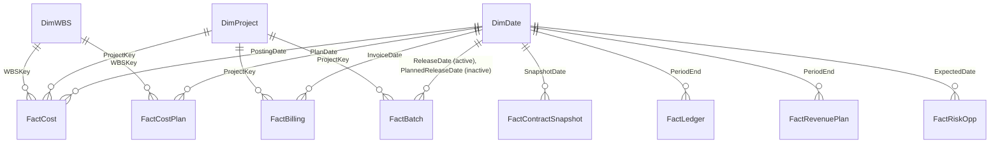

# Pharma Project Finance – Power BI

A small Power BI report that teaches the core finance concepts of **biopharma contract manufacturing**, one page per concept:

| # | Page | Concept | Key question |
|---|---|---|---|
| 1 | Revenue Recognition | IFRS 15, over time (cost-to-cost) vs point in time | When is revenue earned? |
| 2 | WIP & Deferred | Contract assets and liabilities, month-end reconciliation | How does earned compare with billed? |
| 3 | WBS & Project Control | Work breakdown structure, earned value (PV / EV / AC, CPI, SPI) | Are we on budget and on schedule? |
| 4 | Outlook Scenarios | Base / downside / upside / risk-weighted, what-if forecast | Where will the year land against target? |
| 5 | GMP Batches | QA release, failed batches, deviations | How does quality drive revenue? |
| – | Glossary | All terms in one place | |

📄 **Preview without Power BI:** [docs/PharmaProjectFinance.pdf](docs/PharmaProjectFinance.pdf) (PDF export of all pages).

Each page has a **"How to read this page" panel**: what the page shows, the formula in plain words, things to try, and a one-line summary. Pages 1–3 also include a **step-by-step monthly calculation table**, so every number can be traced.

> **All data is synthetic.** It covers one platform, two customers (Customer 001, Customer 002) and three projects. The numbers are round on purpose so they can be recalculated by hand.

## The three projects

| Project | Customer | Revenue rule | What happens in 2026 |
|---|---|---|---|
| **PRJ-101** Development project | Customer 001 | Over time | Price 1.0M, budget 800k. Runs Jan–Aug exactly on budget. This is the "textbook" case. |
| **PRJ-102** Clinical batch project | Customer 002 | Over time | Price 2.0M, budget 1.5M. The engineering run needs rework in June, so the EAC rises to 1.8M (cumulative catch-up). A change order (+300k price / +200k cost) is approved in October. A milestone invoice is not sent, so WIP builds up. The GL misses the change order, giving a 240k reconciliation difference. |
| **PRJ-103** Commercial supply | Customer 001 | Point in time | A 500k advance payment (deferred revenue). Batches of 250k are recognised on QA release. B-304 fails, and B-309 is still under QA review at month-end. |

Actuals run Jan–Oct 2026 and the forecast covers Nov–Dec 2026.

## Learn with it

Start with **[docs/study-guide.md](docs/study-guide.md)**. It walks through the dataset month by month and ends each topic with self-check questions. Then open the report and confirm every number.

The workbook's `RevRec_Example` sheet repeats the revenue and WIP calculation with plain Excel formulas (`SUMIFS`, `MIN`, `IF`). Change the project key in cell B2 to switch project.

## Data model (star schema)



- **4 dimensions:** date (built in DAX), project, WBS, customer.
- **8 fact tables, one per business event:** cost, cost plan, controlling snapshot, invoices, batches, GL extract, budget/forecast, risk register.
- All relationships are one-to-many and single-direction. Every fact table also links to `DimProject` and `DimCustomer` (simplified in the diagram).
- **63 explicit DAX measures** in display folders that follow the pages. Each has a description, and implicit measures are disabled.

More detail: [docs/data-model.md](docs/data-model.md). Every measure with its DAX: [docs/dax-measures.md](docs/dax-measures.md).

### DAX patterns used

- **One "as-of date" for every balance.** Revenue, cost and billing *to date* are read at the end of the period in context, capped at the close date. Period values are closing minus opening (`Revenue Recognised`).
- **Per-project iteration** (`SUMX` over `VALUES`) for % complete, earned value, and WIP vs deferred. Contracts are never netted against each other.
- **Snapshot (semi-additive) measures** for EAC, transaction price and GL balances.
- **`USERELATIONSHIP`** to switch batches from actual release date to planned release date.
- **Disconnected scenario table** with `SWITCH(SELECTEDVALUE())`, and a **what-if parameter** (`GENERATESERIES`).

## How to open it

1. Install **Power BI Desktop** (a recent version).
2. Clone the repo and open `powerbi/PharmaProjectFinance.pbip`.
3. **Transform data → Edit parameters → `DataFolder`**. Enter the full path of the `data` folder, ending with `\`.
4. Click **Refresh**.

```bash
pip install pandas openpyxl
python scripts/generate_data.py      # rebuild data/pharma_project_finance.xlsx
python scripts/reference_calcs.py    # recompute headline numbers independently of Power BI
python scripts/document_measures.py  # regenerate docs/dax-measures.md from the TMDL model
```

## Repository layout

```
data/       pharma_project_finance.xlsx   (11 Excel tables + README + RevRec_Example sheet)
powerbi/    PharmaProjectFinance.pbip      (Power BI Project: TMDL model + PBIR report, all text)
scripts/    generate_data.py · reference_calcs.py · document_measures.py
docs/       study-guide.md · data-model.md · dax-measures.md · demo-script.md
```

Tools: Power BI Desktop (PBIP / TMDL / PBIR) · DAX · Power Query · Excel · Python (pandas, openpyxl)

## License

[MIT](LICENSE)
